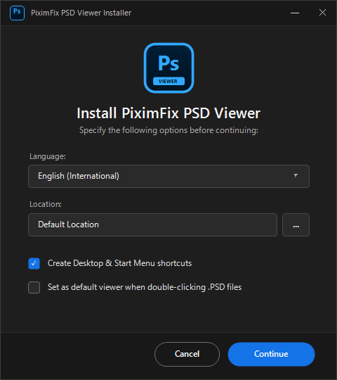
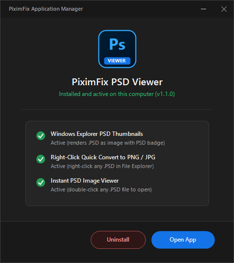

# PiximFix PSD Viewer & Batch Conversion Engine (`v1.1.0`)

[](LICENSE)
[](pyproject.toml)

**View `.PSD` and `.PSB` files directly in Windows File Explorer as real image thumbnails (with a clean `PSD` / `PSB` badge), inspect layer trees from the CLI or Python SDK, and batch-convert `.PSD` to `.PNG` / `.JPG` in milliseconds — without opening Adobe Photoshop.**

Developed by **[PiximFix Studio](https://piximfix.com)** for graphic designers, photo studios, wedding album editors, and developers automating creative pipelines.

---

## Direct Download (Windows 10 / 11 — 64-Bit Desktop & Shell Extension)

- **[Download PiximFix-PSD-Viewer-Setup-v1.1.0.zip (Recommended)](https://github.com/piximfix/piximfix-psd-viewer/releases/download/v1.1.0/PiximFix-PSD-Viewer-Setup-v1.1.0.zip)**
- **[Download PiximFix-PSD-Viewer-Setup.exe (Direct Installer)](https://github.com/piximfix/piximfix-psd-viewer/releases/download/v1.1.0/PiximFix-PSD-Viewer-Setup.exe)**

---

## Key Features

1. **Zero-Dependency Binary `.PSD` (v1) & `.PSB` (v2 64-Bit) Parser (`src/piximfix_psd/`):**
   - Parses 26-byte headers, Color Mode blocks, `8BIM` Image Resource blocks (DPI `0x03ED`, ICC Profiles `0x040F`, XMP `0x0424`), Layer & Mask trees, and Apple PackBits RLE scanlines.
2. **Native Windows Explorer `.PSD` Thumbnails (Zero Reboot Needed):**
   - Automatically renders `.PSD` and `.PSB` files as real image thumbnails inside Windows 10 and Windows 11 File Explorer with a crisp **PSD** corner badge.
3. **Cross-Platform CLI (`piximfix-psd`) & Multi-Threaded Batch Converter:**
   - Inspect layer trees as JSON (`piximfix-psd inspect file.psd --layers`), convert single files (`piximfix-psd convert file.psd --badge`), or batch-export entire studio folders across worker threads (`piximfix-psd batch ./studio_psds -o ./exports --badge`).
4. **Ultra-Fast Standalone PSD Image Viewer:**
   - Double-click any `.PSD` file to open it in under 0.1 seconds with smooth mouse-wheel zoom, click-and-drag pan, and 1-click **Save PNG** / **Save JPG** buttons.

---

## Screenshots

### 1. Fast PSD Image Viewer with 1-Click PNG & JPG Export


### 2. Adobe-Style Dark Setup & Application Manager




---

## Quick Start (Python SDK & CLI)

### Installation (Development & Editable Mode)
```bash
git clone https://github.com/piximfix/piximfix-psd-viewer.git
cd piximfix-psd-viewer
pip install -e ".[dev]"
```

### Run Automated Test Suite (`pytest`)
```bash
pytest
```

### CLI Usage
```bash
# Inspect PSD/PSB metadata & layer hierarchy as JSON
piximfix-psd inspect design.psd --layers

# Convert a single PSD/PSB to PNG (with optional corner badge)
piximfix-psd convert design.psd -o design.png --badge

# Multi-threaded batch conversion across a directory
piximfix-psd batch ./input_psds -o ./rendered_pngs --badge --workers 8
```

---

## Architecture Overview

```text
piximfix-psd-viewer/
├── src/piximfix_psd/
│   ├── __init__.py        # Public SDK exports
│   ├── models.py          # Dataclasses for headers, 8BIM resources, and layer records
│   ├── binary_reader.py   # Big-endian stream reader for 32-bit PSD & 64-bit PSB offsets
│   ├── rle.py             # Apple PackBits RLE encoder/decoder & planar RGBA compositor
│   ├── icc.py             # 8BIM Image Resource parser (ResolutionInfo, ICC, XMP)
│   ├── parser.py          # Full PSD/PSB parser & synthetic test document builder
│   ├── badge.py           # Vector-style PSD/PSB corner badge overlay renderer
│   ├── converter.py       # Zero-dependency zlib PNG encoder & ThreadPool batch runner
│   └── cli.py             # Command-line interface (`piximfix-psd`)
└── tests/                 # Automated pytest suite covering parser, RLE, CLI, and batch export
```

---

## Engineering Roadmap (Upcoming 80+ Hours of Active Development)

- [ ] **Phase 1 — Per-Layer Compositing & Blend Mode Engine (20 hrs):** Implement full Porter-Duff and Photoshop blend modes (`Multiply`, `Screen`, `Overlay`, `Soft Light`, `Color Dodge`) for layer-by-layer rendering when pre-composited image data is disabled (`Maximize Compatibility = Off`).
- [ ] **Phase 2 — ZIP Prediction Compression (`CompressionMethod 2 & 3`) & 16/32-Bit HDR Channels (15 hrs):** Add delta-prediction decompression for 16-bit and 32-bit floating-point `.PSB` studio masters.
- [ ] **Phase 3 — Full ICC Color Profile Transform Engine (15 hrs):** Parse embedded ICC v2/v4 LUT tags (`0x040F`) for accurate Coated FOGRA39 / US Web Coated (SWOP) CMYK-to-sRGB conversion without external C libraries.
- [ ] **Phase 4 — Smart Object (`SoLd` / `PlLd`) & Text Layer (`TySh`) Extraction (15 hrs):** Extract embedded Smart Object binaries and parse descriptor structures for typography metadata inspection.
- [ ] **Phase 5 — Streaming Chunked Reader for Multi-Gigabyte `.PSB` Files & WebP/JPEG Encoders (15 hrs):** Memory-mapped (`mmap`) scanline streaming to keep RAM usage under 64 MB on 10 GB+ `.PSB` wedding album files.

---

## License

Released under the **[MIT License](LICENSE)** — Copyright (c) 2026 Roshan Kumar (**[PiximFix.com](https://piximfix.com)**).
